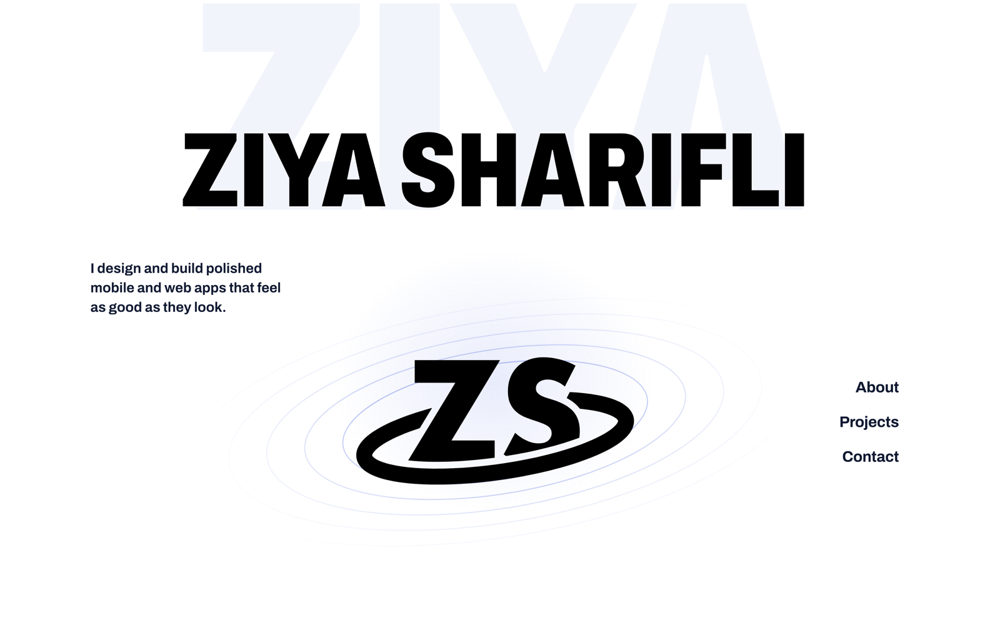
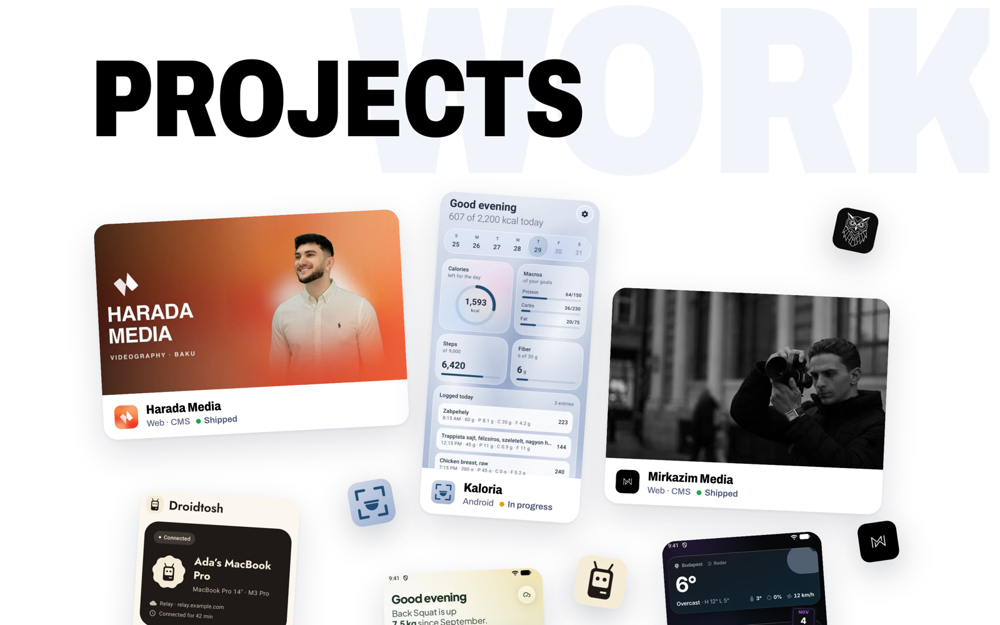
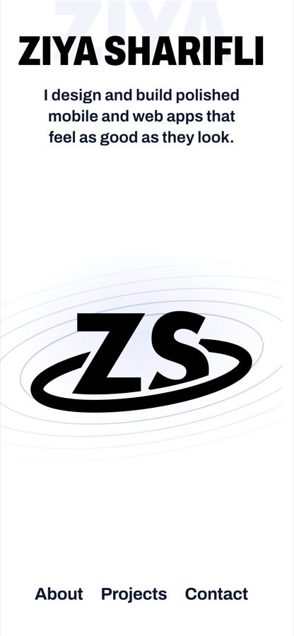
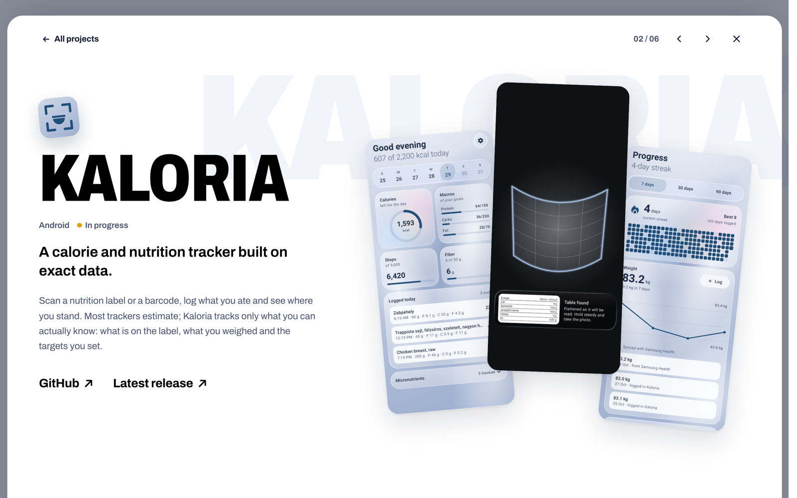

<div align="center">


# ziyasharifli.dev

**The personal site of Ziya Sharifli, a mobile and web developer in Budapest.**

Who I am, the apps I've built and how to reach me, on one page. Each project opens into its own
sheet with screenshots, features and the stack behind it.

[](https://github.com/southstar21dev/personal-portfolio/actions/workflows/ci.yml)
[](https://ziyasharifli.dev)


<br />




</div>

## What's on it

<table>
<tr>
<td width="50%" valign="top">

### A one-page site

The hero, **About**, **Projects** and **Contact**, with smooth scrolling between them. The hero
drifts apart as you scroll away, and the large pale words behind each heading slide past.

</td>
<td width="50%" valign="top">

### The logo intro

On the first visit of a session, the ZS mark draws itself in the middle of the screen and then
glides into its place in the hero. It doesn't play for visitors who prefer reduced motion or who
arrive on a section link.

</td>
</tr>
<tr>
<td width="50%" valign="top">

### Projects as a scatter

On desktop the cards are scattered at different tilts and depths, and they follow the pointer
and the scroll. On phones and tablets they become a tidy grid.

</td>
<td width="50%" valign="top">

### A sheet for every project

A card opens the project in a sheet with its own URL (`/#kaloria`), so it can be shared and the
Back button closes it. Each sheet has hero screenshots, rows of screens, what the app does and its
stack, and you can move to the next project without closing it.

</td>
</tr>
<tr>
<td align="center"></td>
<td align="center"></td>
</tr>
</table>

## Built with

SvelteKit 3 · Svelte 5 (runes) · TypeScript · plain CSS (scoped, with shared tokens and classes in `global.css`) ·
[`@sveltejs/enhanced-img`](https://svelte.dev/docs/kit/images) (AVIF/WebP at build) ·
[Lenis](https://github.com/darkroomengineering/lenis) smooth scrolling · CSS scroll-driven
animations · Vitest · Playwright · nginx.

Every page is prerendered to static HTML by `adapter-static`; there's no server code. The
detail sheets and their ~100 screenshots load on demand, so they stay out of the first download.

<details>
<summary>Where things live</summary>

| Path                         | Contents                                                                                                                                                                            |
| ---------------------------- | ----------------------------------------------------------------------------------------------------------------------------------------------------------------------------------- |
| `src/app.html`               | Decides whether to play the logo intro, before first paint                                                                                                                          |
| `src/routes/+page.svelte`    | The whole site: the hero, then each section                                                                                                                                         |
| `src/lib/site.ts`            | Email, social links and the resume's path                                                                                                                                           |
| `src/lib/projects.ts`        | Project content: name, status, summary, features, stack, screens                                                                                                                    |
| `src/lib/projects-media.ts`  | Card screenshots and app icons, keyed by slug                                                                                                                                       |
| `src/lib/project-screens.ts` | Detail screenshots and the hero fan layouts (loaded lazily)                                                                                                                         |
| `src/lib/intro.ts`           | Every timing in the logo intro, and its session key                                                                                                                                 |
| `src/lib/motion.ts`          | Lenis, scroll-linked CSS variables, reveal on scroll, the scroll lock                                                                                                               |
| `src/lib/image-loading.ts`   | Spinner and fade-in while images load, preloading                                                                                                                                   |
| `src/lib/components/`        | `Splash` and `IntroLogo` (the intro), `Orbits`, `AboutSection`, `ProjectsSection`, `ProjectDetail` with `HeroFan`, `ScreenStrip` and `ProjectPager`, `ContactSection`, `SiteFooter` |
| `src/lib/styles/global.css`  | Colour, shadow and type tokens, plus the shared classes                                                                                                                             |
| `src/lib/assets/`            | The ZS mark, the portrait and the project images                                                                                                                                    |
| `static/`                    | Favicons, the web manifest, `robots.txt` and the resume PDF                                                                                                                         |
| `tests/site.e2e.ts`          | Playwright tests, run in Chromium and WebKit                                                                                                                                        |
| `nginx/`                     | The server config and the security headers                                                                                                                                          |

</details>

## Development

```sh
npm install
npm run dev              # http://localhost:5173

npm run check            # type-check Svelte and TypeScript
npm run lint             # Prettier (npm run format to fix)
npm run test:unit        # Vitest
npm run test:e2e:setup   # once: install the Playwright browsers
npm run test:e2e         # Chromium and WebKit, against the production build
npm run build            # prerender into build/
```

Every push to `main` and every pull request runs CI: formatting, type checks, unit tests and
the browser tests.

### Adding a project

1. Add its slug to `Slug` and its entry to `projects` in `src/lib/projects.ts`. Run
   `npm run check` after this step: it lists every map in steps 2–4 that still needs the new slug.
2. Put its card screenshot (`<slug>.jpg`: phone ≈ 460×800, web ≈ 880×492) and app icon
   (`<slug>-icon.png`, 256×256) in `src/lib/assets/projects/`, and import them in `projects-media.ts`.
3. Put its detail screenshots in `src/lib/assets/projects/screens/<slug>/`, named as in the
   entry's `hero.names` and `screens`. The hero layout sets how many `hero.names` fit: three
   for `phones`, two for `mac`, one for `web`.
4. Give it a spot in `place`, and optionally a floating icon in `floating`, in
   `ProjectsSection.svelte`.

Use each app's **real native app icon and native screenshots**, not web or favicon versions.
`npm run test:unit` checks that every image a project names exists.

### The resume

The PDF in `static/ziya-sharifli-resume.pdf` is exported from the resume's Word file. To update
it, export a new PDF over it; the path is in `src/lib/site.ts`.

## Deploy

The `Dockerfile` builds the site with Node and serves `build/` with nginx (`nginx/`). In Coolify:
**New → Application → this repo → Build Pack: Dockerfile**, port 80. No environment variables are
needed.

nginx sends the security headers in `nginx/security-headers.conf`. SvelteKit writes the
Content-Security-Policy into every page, with hashes of its inline scripts (`csp` in
`vite.config.ts`).

## License

Copyright © 2026 Ziya Sharifli. **All rights reserved.** The source is published for reference;
it isn't licensed for reuse. The writing, photos, logo and project screenshots are mine and may
not be reused.

## Credits

- Type: [Archivo](https://fonts.google.com/specimen/Archivo) (SIL Open Font License), self-hosted
  via `@fontsource-variable/archivo`.
- Smooth scrolling: [Lenis](https://github.com/darkroomengineering/lenis) (MIT).
